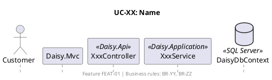

# Sync Docs

A change to a requirement or to the technology is not done until every doc that describes it agrees. This skill finds the affected docs, updates them in the right order, and verifies the result.

## Ground rules

- Docs are written in **English**. Do not translate existing text. Reply to the user in the language they use.
- **Never edit `docs/docx/*`** (e.g. `features.docx`). It is for humans only. Instead, tell the user which part of it is now out of date.
- Read the docs as defined in [`.claude/rules/reading-docs.md`](../../rules/reading-docs.md) before editing anything.
- If the change contradicts an earlier decision recorded in the docs, or is ambiguous in a way that changes what you would write, ask the user before editing. Otherwise choose a sensible default and list it in the final report.
- Never renumber or reuse an ID (`BR-XX`, `UC-XX`). New items take the next free number.

## Doc map: who owns what

Edit the owner first, then the docs that repeat or reference it.

| Concern | Owner (source of truth) | Also described in |
|---|---|---|
| Business behavior, constraints, formulas | `.claude/business-rules/BR-XX.md` | UC "Business rules" row, sequence footers and `(BR-XX)` notes, API_DESIGN validation and error codes, ARCHITECTURE domain-rule sections |
| User goals and flows | `.claude/use-cases/UC-XX.md` | Sequence diagram `UC-XX.puml`, BR "Used by" row, API_DESIGN endpoint "UC" column |
| Request flow per use case, endpoints called | `.claude/sequences/UC-XX.puml` | Sequences README index and "Endpoint Summary" |
| Tables, columns, constraints, indexes | `infra/database/DaisyDB.sql` | ARCHITECTURE entities / enums / configurations / field lists, API_DESIGN DTOs and enums, BR "Enforced by" and "Notes", UC "Data" row |
| Projects, layers, tech stack, cross-cutting design | `docs/md/ARCHITECTURE.md` | API_DESIGN conventions, security and configuration; sequence participants |
| HTTP contract (routes, DTOs, status and error codes) | `docs/md/API_DESIGN.md` | Sequence messages, sequences README endpoints, ARCHITECTURE endpoint examples |
| Original requirements (human) | `docs/docx/features.docx` | — read-only for you; report gaps |

Indexes that must list every item: `.claude/business-rules/README.md`, `.claude/use-cases/README.md` (group tables + "Feature to Use Case Map"), `.claude/sequences/README.md` (index + "Endpoint Summary"), API_DESIGN §8 "Endpoint Index" and §9 "Controller Map".

## Impact checklist by change type

Use the rows that match the change; a change often matches several.

**Business rule added / changed / removed**
- [ ] `BR-XX.md` (rule, details, "Enforced by", "Used by", notes)
- [ ] BR README row (name, summary, used by)
- [ ] Each UC in "Used by": "Business rules" row and any step that applies the rule
- [ ] Sequence diagrams of those UCs: footer and `(BR-XX)` messages
- [ ] API_DESIGN: validation rules, error codes (§4.3), affected endpoint text
- [ ] ARCHITECTURE: domain rules, flows that describe the behavior
- [ ] DaisyDB.sql if the database enforces it (constraint / index)

**Use case / feature added, changed or removed**
- [ ] `UC-XX.md` (actors, data, business rules, flows, related use cases)
- [ ] UC README: group table, feature map; mark features not in features.docx as `— (added)`
- [ ] `UC-XX.puml` + sequences README index and Endpoint Summary
- [ ] BRs it uses: "Used by" row (both directions)
- [ ] API_DESIGN: endpoint section, §8 index (renumber rows), §9 controller map, permissions (§3.3)
- [ ] ARCHITECTURE: features list, controllers, flows if the use case changes them

**Data model change (table, column, constraint, enum value)**
- [ ] DaisyDB.sql: table, constraints, indexes, the comment block above the table, header notes, table count in the header and in the final `PRINT`
- [ ] ARCHITECTURE: entities list, enums table, configurations list, field lists, `IApplicationDbContext` example
- [ ] API_DESIGN: DTO examples, enums (§5.1), OData entity properties (§7)
- [ ] BRs: "Enforced by", remove "Notes" gaps that are now enforced
- [ ] UCs: "Data" row; sequences: SQL-like messages that name columns

**API change (route, request/response shape, status or error code)**
- [ ] API_DESIGN: endpoint section, error codes, §8 index, §9 controller map
- [ ] Sequence diagrams that call it + sequences README Endpoint Summary
- [ ] ARCHITECTURE endpoint examples (REST controllers, payment section)

**Technology change (framework, library, provider, hosting, auth mechanism)**
- [ ] ARCHITECTURE: "Backend Technology Stack" table, affected sections, structure trees (§9, §30), dependency diagram
- [ ] API_DESIGN: conventions (§2), auth (§3), security (§10), configuration (§11)
- [ ] Sequence participants whose interface or class names change
- [ ] BR "Enforced by" when the enforcing mechanism changes

**Open question resolved**
- [ ] API_DESIGN §12: move it from the table to "Resolved (date)"
- [ ] Remove the matching "Notes" gap in BR / UC files; apply the decision in every doc above

## Procedure

1. **Restate the change** in one or two sentences: what changes, why, and which change types above apply.
2. **Find every mention.** Search for the old names, IDs, columns, endpoints, enum values and config keys, for example:
   ```bash
   grep -rnE "OldTerm|BR-32|/api/orders/\{id\}/payment-qr|PaymentStatus" .claude docs/md infra/database --include=*.md --include=*.puml --include=*.sql
   ```
   Add each file found to the plan; do not trust memory of where things are.
3. **Edit owners first**, then everything that repeats them, following the checklist. Keep cross-references two-way: a BR's "Used by" and each UC's "Business rules" must agree.
4. **Match the existing format** (templates below). Keep tables, headings and wording style of neighbouring files.
5. **Verify** (all must pass):
   - Run the checker, passing renamed or removed terms as `--stale`:
     ```bash
     python .claude/skills/sync-docs/scripts/check_docs.py --stale Cancelled OldTerm
     ```
     Fix every `ERROR`; fix `WARN` lines unless the asymmetry is intended.
   - If `DaisyDB.sql` changed, run it on a **renamed copy** in LocalDB, never against the real `[Daisy]` database (the script drops it):
     ```bash
     sed -e "s/\[Daisy\]/[DaisyScriptTest]/g" -e "s/N'Daisy'/N'DaisyScriptTest'/g" infra/database/DaisyDB.sql > "$TMP/test.sql"
     sqlcmd -S "(localdb)\MSSQLLocalDB" -I -b -i "$TMP/test.sql"
     # then: DROP DATABASE [DaisyScriptTest]
     ```
     `-I` (QUOTED_IDENTIFIER ON) is required because of the filtered indexes. Use the scratchpad directory for `$TMP`.
   - Re-run the grep from step 2 for the old terms; only intended mentions may remain.
6. **Report** to the user:
   - files changed, grouped by folder;
   - new IDs created (BR / UC / endpoints);
   - defaults you chose that the user should confirm;
   - sections of `docs/docx/features.docx` that are now out of date (feature IDs), since only a human edits it.

## Templates

### Business rule (`.claude/business-rules/BR-XX.md`)

```markdown
# BR-XX: Short Name

| Field | Value |
|---|---|
| ID | BR-XX |
| Category | Account & Access / Product Catalog / Checkout & Payment / ... |
| Enforced by | Application / Database (`CONSTRAINT_NAME`) + Application |
| Source feature(s) | FEAT-01 (or "— (design decision, not in features.docx)") |
| Used by | [UC-YY](../use-cases/UC-YY.md) |

## Rule

One or two sentences stating the rule.

## Details

- Precise conditions, formulas, edge cases.

## Notes

- Known gaps between the rule and the current schema (omit the section if none).
```

### Use case (`.claude/use-cases/UC-XX.md`)

```markdown
# UC-XX: Name

| Field | Value |
|---|---|
| ID | UC-XX |
| Feature | FEAT-01 (or "— (extends FEAT-01; not in features.docx)") |
| Group | Same group name as in the README |
| Actor(s) | Guest / Customer / Staff / Admin / System |
| Data | Tables touched |
| Business rules | [BR-YY](../business-rules/BR-YY.md) |

## Description
## Preconditions
## Main Flow
1. ...
## Alternative Flows
- **A1. Name**: At step N, ...
## Postconditions
## Related Use Cases   (optional)
## Notes               (optional)
```

### Sequence diagram (`.claude/sequences/UC-XX.puml`)



Participants follow ARCHITECTURE: `Daisy.Mvc` → `Daisy.Api` controller → `Daisy.Application` service → `DaisyDbContext`, with external services behind `Daisy.Infrastructure` interfaces. Admin diagrams add `note over API : Requires role: ...`.

## Project conventions to preserve

- `OrderStatus` value is `Canceled` (database spelling), never `Cancelled`.
- VietQR is stored as `PaymentMethod = Online`.
- Enum names equal the database `CHECK` constraint values.
- REST under `/api`, admin under `/api/admin`, OData (read-only lists) under `/odata` with camelCase properties.
- Error body: `{ status, code, message, errors, details, traceId }`; codes listed in API_DESIGN §4.3.
- Features not in `features.docx` are marked `— (added)` / "design decision".
